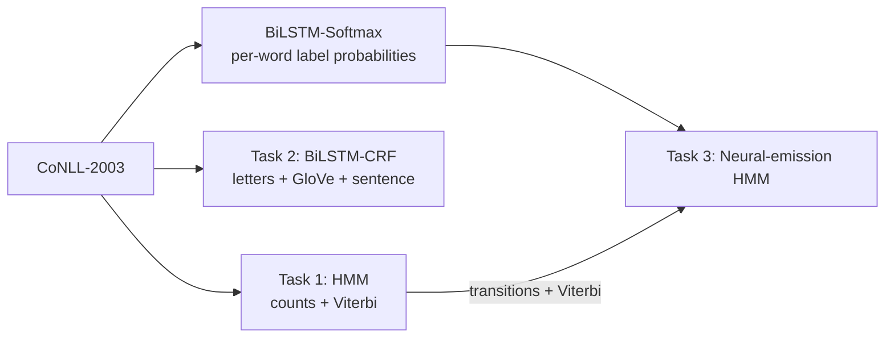

# NLP_PROJECT2_24CS10058
# Statistical vs. Neural Sequence Labeling on CoNLL-2003


[](https://github.com/pcr1304/NLP_PROJECT2_24CS10058/blob/main/Project.ipynb)

Three taggers for **named entity recognition (NER)** on the same data, built from scratch and compared:

1. **HMM**: a Hidden Markov Model that learns by counting.
2. **BiLSTM-CRF**: a neural tagger (a reproduction of Lample et al., 2016).
3. **Neural-emission HMM**: the HMM's structure with the neural network's scores plugged in.

```
Barack   Obama   visited   Paris   with   Google   .
B-PER    I-PER   O         B-LOC   O      B-ORG    O
```

---

## Results

Entity-level scores on the CoNLL-2003 **test set** (scored with `seqeval`).

| Model | Precision | Recall | F1 |
|---|---|---|---|
| Task 1: HMM (counting) | 0.7663 | 0.7020 | 0.7328 |
| Task 2: BiLSTM-CRF | 0.9058 | 0.9076 | **0.9067** |
| BiLSTM-Softmax (extra baseline) | 0.8875 | 0.9026 | 0.8950 |
| Task 3: Neural-emission HMM | 0.8941 | 0.8952 | 0.8946 |

The BiLSTM-CRF result is close to the roughly 90.9 F1 reported in the original paper.

**F1 by entity type (test):**

| Type | HMM | BiLSTM-CRF | BiLSTM-Softmax | Hybrid |
|---|---|---|---|---|
| PER | 0.7666 | 0.9565 | 0.9538 | 0.9525 |
| LOC | 0.7923 | 0.9272 | 0.9157 | 0.9240 |
| ORG | 0.6526 | 0.8853 | 0.8645 | 0.8668 |
| MISC | 0.6917 | 0.7952 | 0.7848 | 0.7580 |

### What we found

- **Counting has a ceiling.** The HMM only sees the current word, so it misses names it has never seen. Its recall (0.702) is lower than its precision (0.766).
- **Context and character clues help a lot.** The BiLSTM-CRF is about 17 F1 points above the HMM.
- **The CRF adds a smaller gain.** It is about 1.2 points above the same network with softmax. It scores whole label chains and avoids illegal ones such as `O` followed by `I-PER`.
- **The hybrid recovers most of the gap.** It goes from 0.733 to 0.895 by replacing only the emission scores, but it does not beat the CRF. The BiLSTM already reads the whole sentence, so the HMM's counted transitions add little.
- **MISC is the hardest type** for every model, because it covers a mixed set of names.

> **Caveat:** each number comes from one run (seed 7). Small differences, such as hybrid vs. softmax (0.0004 apart, about 2 names out of 5,648), are within noise. Only the large gaps are safe conclusions.

---

## How it works



**Task 1: HMM.** Counts how often a label follows another label (transitions) and how often a label goes with a word (emissions), with add-λ smoothing (λ = 0.1). Unseen words are scored from their last 1 to 3 letters and capitalization. Viterbi, in log-space, finds the best label chain.

**Task 2: BiLSTM-CRF.** A character BiLSTM (25 units per direction) and 100-d GloVe vectors feed a word-level BiLSTM (100 units per direction, dropout 0.5). A linear-chain CRF, written from scratch, sits on top. Training uses SGD (momentum 0.9, learning rate 0.015 decayed as 1/(1 + 0.05 x epoch)), gradient clipping at 5.0, up to 50 epochs and early stopping on validation F1 (patience 5).

**Task 3: Neural-emission HMM.** The same encoder with a softmax output gives P(label | word, sentence). The HMM needs P(word | label), so Bayes' rule is used: log emission = log softmax - alpha x log prior(label), with alpha = 1 as specified. The Task 1 transitions and Viterbi decoder are reused unchanged.

---

## Quick start

**1. Install**

```bash
pip install -r requirements.txt
```

On Colab, PyTorch is already installed, so this is enough:

```python
!pip install -q seqeval "datasets<4"
```

**2. Download GloVe** (needed only for training)

```bash
wget https://downloads.cs.stanford.edu/nlp/data/glove.6B.zip
unzip -q glove.6B.zip glove.6B.100d.txt
```

**3. Run the three tasks**

```bash
python hmm_tagger.py                                             # Task 1
python bilstm_crf.py --glove glove.6B.100d.txt --head crf        # Task 2
python bilstm_crf.py --glove glove.6B.100d.txt --head softmax    # encoder for Task 3
python hybrid.py                                                 # Task 3 + comparison table
```

Use a GPU for the two neural runs. On a Colab GPU, the full CRF run took about 49 minutes and the softmax run about 37 minutes.

**4. Try your own sentence**

This prints the three models' labels side by side and marks with `*` the words where they disagree.

### Skip training with the saved models

The trained checkpoints are in `models/`. The scripts look for them in the main folder, so copy them first:

```bash
cp models/*.pt .
python hybrid.py
```

---

## Project structure

```
.
├── dataio.py         # data loading, label order, entity-level scoring, result files
├── hmm_tagger.py     # Task 1: count-based HMM + log-space Viterbi
├── bilstm_crf.py     # Task 2: encoder, from-scratch CRF, softmax head, training loop
├── hybrid.py         # Task 3: neural-emission HMM and the comparison table
├── demo.py           # tag your own sentences with all three models
├── models/           # best_crf.pt, best_softmax.pt (trained checkpoints)
├── out/              # task1.json, task2.json, task2_softmax.json, task3.json
├── requirements.txt
└── README.md
```

## Limitations

- Results come from a single seed. Running several seeds (`--seed 1`, `--seed 2`, ...) and reporting the mean and spread would show which differences are real.
- The optional MEMM variant from Task 3 was not implemented.
- Re-running training overwrites `best_crf.pt`, `best_softmax.pt` and the files in `out/`, and the numbers may change slightly.
